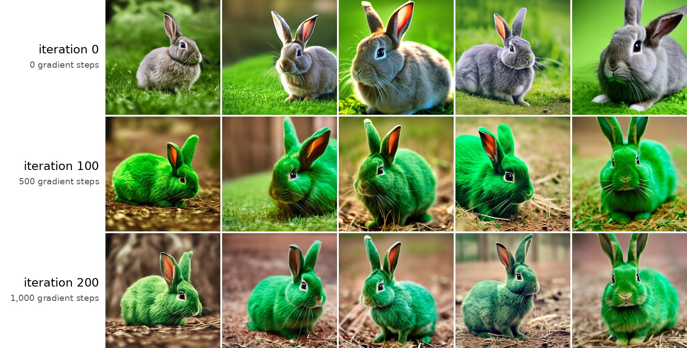
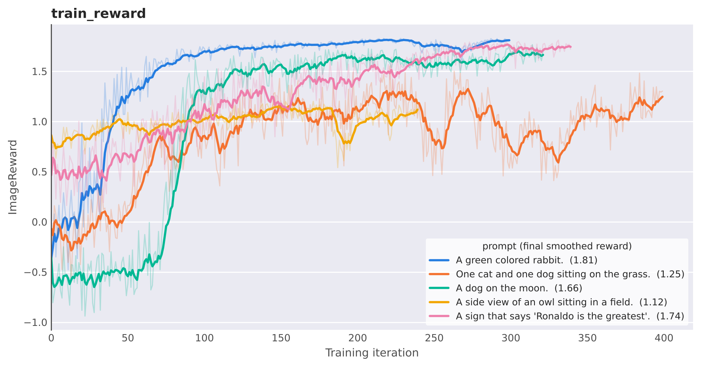
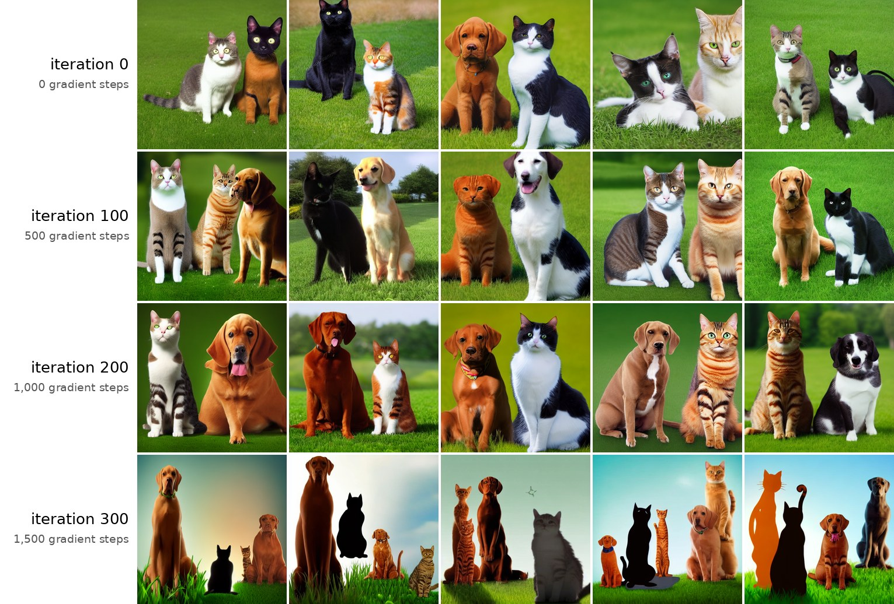
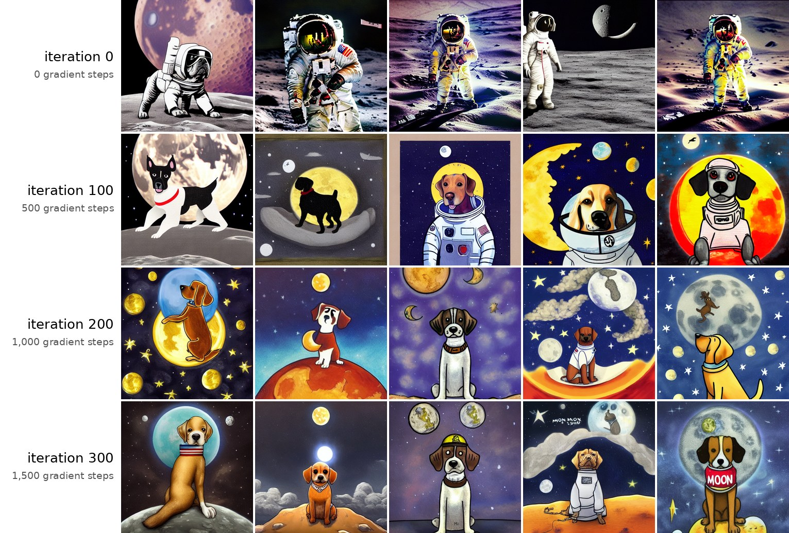
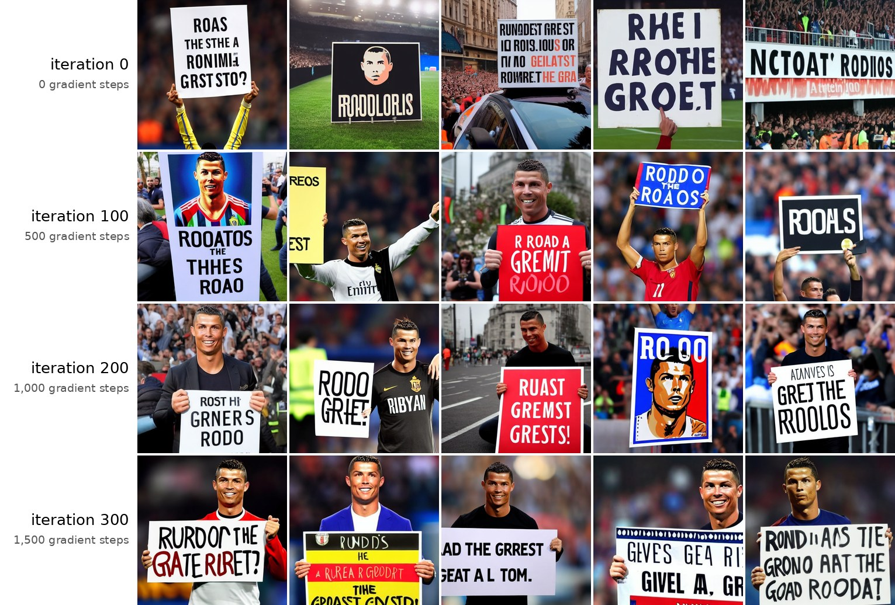

# Diffusion GRPO: Fine-Tuning Diffusion Models via Online Reinforcement Learning

[](LICENSE)
[](https://www.python.org/)
[](https://pytorch.org/)

This repository fine-tunes **Stable Diffusion v1.5** with **GRPO** (Group Relative Policy Optimization), using **[ImageReward](https://github.com/zai-org/ImageReward)** as the reward model. The code is adapted from the official implementation of **[DPOK](https://github.com/google-research/google-research/tree/master/dpok)**. DPOK trains an actor and a critic (a value network). Here the critic is removed: for each prompt, a group of images is sampled and every image is scored against the rest of its group.

On the single prompts tried so far, GRPO reaches ImageReward scores of about 1.7 to 1.8 within 1,500 to 1,700 gradient steps. DPOK reports its single-prompt results after 10K gradient steps.

<p align="center">
  
</p>
<p align="center"><em>"A green colored rabbit." Each row is a saved checkpoint, and each column uses the same random seed.</em></p>

## Contents

- [How it works](#how-it-works)
- [Results](#results)
- [Installation](#installation)
- [Training](#training)
- [Sampling from a checkpoint](#sampling-from-a-checkpoint)
- [Configuration](#configuration)
- [Repository layout](#repository-layout)
- [Acknowledgements](#acknowledgements)
- [Citation](#citation)

## How it works

Denoising is treated as a Markov decision process. Each of the 50 DDIM steps (with η = 1) is a Gaussian policy step, and the reward is the ImageReward score of the final image. Each iteration works like this:

1. **Collect a group.** Sample G images (G = 18 by default) for the same prompt with the current weights. Store every denoising transition and its log-probability.
2. **Score them relative to the group.** Score each image with ImageReward. The advantage of image *i* is `(r_i - mean(r)) / (std(r) + ε)`, computed within the group and shared by all 50 steps of that image's trajectory. No value network is needed.
3. **Update the policy.** Take a few PPO-style clipped policy-gradient steps on the stored transitions. Once the warm-up has passed, add a per-step KL penalty to the frozen pre-trained model (the upper bound used in DPOK).

Only LoRA adapters are trained: rank 4 on the `to_q`, `to_k`, `to_v` and `to_out.0` projections of the UNet attention blocks. That covers both cross-attention and self-attention, 797,184 parameters in total. The VAE, the text encoder and the original UNet weights stay frozen.

## Results

Each run below fine-tunes on a **single prompt**. I didn't have the compute to train on the full prompt set.

<p align="center">
  
</p>

| Prompt | Learning rate | KL from iteration | Iterations | Gradient steps | Images sampled | ImageReward (first 10 → last 10 iterations) |
|---|---|---|---|---|---|---|
| A green colored rabbit. | 5e-5 | 150 | 300 | 1,500 | 4,800 | −0.04 → 1.81 |
| One cat and one dog sitting on the grass. | 1e-4 | 300 | 400 | 2,000 | 7,200 | −0.10 → 1.22 |
| A dog on the moon. | 5e-5 | 170 | 322 | ≈1,600 | 5,796 | −0.57 → 1.67 |
| A side view of an owl sitting in a field. | 1e-4 | 110 | 240 | 1,200 | 4,320 | 0.78 → 1.10 |
| A sign that says 'Ronaldo is the greatest'. | 5e-5 | 170 | 340 | 1,700 | 6,120 | 0.51 → 1.75 |

What the samples show:

- **Green rabbit: a clean success.** The base model mostly draws grey rabbits on green grass. After 100 iterations, every sample is a photorealistic green rabbit.
- **Cat and dog: too aggressive.** By iterations 100 to 200, nearly every sample has exactly one cat and one dog. By iteration 300, with the higher learning rate and no KL penalty yet, the samples collapse into stylised silhouettes of three or four animals. This matches the dip in the reward curve.
- **Dog on the moon: a hard prompt.** The base model mostly draws human astronauts. After fine-tuning there is always a dog on the moon, but the style drifts from photos to cartoons.
- **Ronaldo sign: the reward isn't strong enough.** The reward rises, but the text on the sign stays garbled. The model adds a Ronaldo-like face instead, which ImageReward rewards. A reward that actually checks the text would be needed here.
- **Owl:** the reward barely moves, and the base model rarely produces a true side view. Sample grids will be added later.

<details>
<summary>Sample grids for the other prompts</summary>

<p align="center"></p>
<p align="center"><em>"One cat and one dog sitting on the grass." (learning rate 1e-4, KL from iteration 300)</em></p>

<p align="center"></p>
<p align="center"><em>"A dog on the moon." (learning rate 5e-5, KL from iteration 170)</em></p>

<p align="center"></p>
<p align="center"><em>"A sign that says 'Ronaldo is the greatest'." (learning rate 5e-5, KL from iteration 170)</em></p>

</details>


## Installation

The pinned environment uses Python 3.11 and CUDA 12.1 wheels.

```bash
git clone https://github.com/Quancoder260503/Fine-Tuning-Diffusion-Model-via-Online-Reinforcement-Learning-.git
cd Fine-Tuning-Diffusion-Model-via-Online-Reinforcement-Learning-

uv venv --python 3.11 .venv
source .venv/bin/activate
uv pip install -r requirements.lock.txt
uv pip install tensorboard                   # without it, accelerate silently writes no logs
uv pip install image-reward==1.5 --no-deps   # its dependencies are already in the lock file
```

The first run downloads `runwayml/stable-diffusion-v1-5`, `openai/clip-vit-large-patch14` and the `ImageReward-v1.0` checkpoint.

## Training

Fine-tune on one prompt. This reproduces the green-rabbit run:

```bash
accelerate launch TrainGRPO.py \
  --single_prompt "A green colored rabbit." \
  --learning_rate 5e-5 --lora_rank 4 \
  --grpo_samples_per_group 16 --g_batch_size 1 \
  --policy_step 5 --policy_batch_size 8 --gradient_accumulation_steps 20 \
  --max_train_steps 1500 \
  --kl_weight 0.001 --kl_warmup 150 --reward_weight 1.0
```

`--max_train_steps` counts gradient steps. The number of iterations is `max_train_steps / policy_step`. Set `--reward_weight` and `--kl_weight` explicitly, because the defaults in `Parser.py` (100 and 0.01) are DPOK-style values that weren't used here.

A LoRA checkpoint is saved every `--save_interval` iterations (100 by default). To watch training:

```bash
tensorboard --logdir GRPOOnlineModel
```

`TrainPPO.py` is the DPOK-style actor-critic version, with a learned value network, for comparison.

## Sampling from a checkpoint

```bash
# fine-tuned model
python Test.py --prompt "A green colored rabbit." \
  --model_path "GRPOOnlineModel/img_reward_0/pre_train/single_prompt/A_green_colored_rabbit./p_lr5e-05_s5_b8_g20_l4_kl0.001_re1.0_klw150_v_lr0.0001_b256_s5/save_200" \
  --out_dir samples/rabbit_200 --num_images 10

# base model, for comparison
python Test.py --prompt "A green colored rabbit." --base --out_dir samples/rabbit_base --num_images 10
```

This saves the individual images and a `grid.png`. Sampling uses the same settings as training: 50 DDIM steps, η = 1 and guidance scale 7.5.

## Configuration

Every option is a command-line flag in `Parser.py`. The settings shared by all runs above:

| Setting | Flag | Value |
|---|---|---|
| LoRA rank (alpha = rank) | `--lora_rank` | 4 |
| Group size G | `--grpo_samples_per_group` | 18 (16 for the rabbit) |
| Prompts per iteration | `--g_batch_size` | 1 |
| Policy steps per iteration | `--policy_step` | 5 |
| Minibatch per pass | `--policy_batch_size` | 10 (8 for the rabbit) |
| Gradient accumulation | `--gradient_accumulation_steps` | 20 |
| PPO clip range | `--ratio_clip` | 1e-4 |
| Gradient-norm clip | `--clip_norm` | 0.1 |
| KL weight | `--kl_weight` | 0.001 |
| Reward weight | `--reward_weight` | 1.0 |
| Optimiser | | AdamW, constant learning rate, no weight decay |
| Sampler | | DDIM, 50 steps, η = 1, guidance 7.5, 512 × 512 |
| Precision | `--mixed_precision` | fp16 (LoRA weights in fp32) |

Each run's full configuration is also stored in its TensorBoard log (the HPARAMS tab), and its main settings are in the output folder name:

```
GRPOOnlineModel/img_reward_0/pre_train/single_prompt/<prompt>/
  p_lr{learning_rate}_s{policy_step}_b{policy_batch_size}_g{gradient_accumulation_steps}_l{lora_rank}
  _kl{kl_weight}_re{reward_weight}_klw{kl_warmup}_v_lr..._b..._s...
```

The trailing `_v_...` fields are left over from DPOK's value network and are not used by GRPO.

## Repository layout

| Path | What it is |
|---|---|
| `TrainGRPO.py` | GRPO training loop: group sampling, group-relative advantages, clipped policy updates, KL penalty |
| `TrainPPO.py` | DPOK-style actor-critic baseline with a learned value network |
| `ModelPipeline.py` | Stable Diffusion pipeline extended to record trajectories and per-step log-probabilities |
| `SchedulingDDIM.py` | DDIM scheduler extended with Gaussian log-probabilities of each step |
| `Utils.py` | ImageReward scoring, batching, checkpoint saving |
| `RewardModel.py` | Custom reward model (`--reward_flag 1`) and the value networks used by `TrainPPO.py` |
| `Parser.py` | All command-line options |
| `Test.py` | Sample images and a grid from the base model or a LoRA checkpoint |
| `dataset/drawbench/data_meta.json` | DrawBench prompts with categories |
| `GRPOOnlineModel/` | LoRA checkpoints, TensorBoard logs and sample grids from the runs above |
| `assets/` | Figures used in this README |
| `requirements.lock.txt` | Pinned dependencies |

## Acknowledgements

- The training code is adapted from the official **DPOK** implementation by Fan et al.: [google-research/google-research/dpok](https://github.com/google-research/google-research/tree/master/dpok).
- The reward model is **ImageReward** by Xu et al. ([zai-org/ImageReward](https://github.com/zai-org/ImageReward), Apache-2.0).
- GRPO comes from **DeepSeekMath** (Shao et al., 2024).
- Thanks to my supervisor for the suggestion that started this project.

## Citation

If this repository is useful to you, please cite the works it builds on:

```bibtex
@inproceedings{fan2023dpok,
  title     = {{DPOK}: Reinforcement Learning for Fine-tuning Text-to-Image Diffusion Models},
  author    = {Fan, Ying and Watkins, Olivia and Du, Yuqing and Liu, Hao and Ryu, Moonkyung and Boutilier, Craig and Abbeel, Pieter and Ghavamzadeh, Mohammad and Lee, Kangwook and Lee, Kimin},
  booktitle = {Advances in Neural Information Processing Systems},
  volume    = {36},
  year      = {2023}
}

@inproceedings{xu2023imagereward,
  title     = {{ImageReward}: Learning and Evaluating Human Preferences for Text-to-Image Generation},
  author    = {Xu, Jiazheng and Liu, Xiao and Wu, Yuchen and Tong, Yuxuan and Li, Qinkai and Ding, Ming and Tang, Jie and Dong, Yuxiao},
  booktitle = {Proceedings of the 37th International Conference on Neural Information Processing Systems},
  pages     = {15903--15935},
  year      = {2023}
}

@article{shao2024deepseekmath,
  title   = {{DeepSeekMath}: Pushing the Limits of Mathematical Reasoning in Open Language Models},
  author  = {Shao, Zhihong and Wang, Peiyi and Zhu, Qihao and Xu, Runxin and Song, Junxiao and others},
  journal = {arXiv preprint arXiv:2402.03300},
  year    = {2024}
}

@misc{le2026diffusiongrpo,
  title        = {Diffusion {GRPO}: Fine-Tuning Diffusion Models via Online Reinforcement Learning},
  author       = {Le, Minh Quan},
  year         = {2026},
  howpublished = {\url{https://github.com/Quancoder260503/Fine-Tuning-Diffusion-Model-via-Online-Reinforcement-Learning-}}
}
```

## License

This project is licensed under the Apache License 2.0. See [LICENSE](LICENSE). The DPOK and ImageReward code and weights it builds on are covered by their own licenses.
